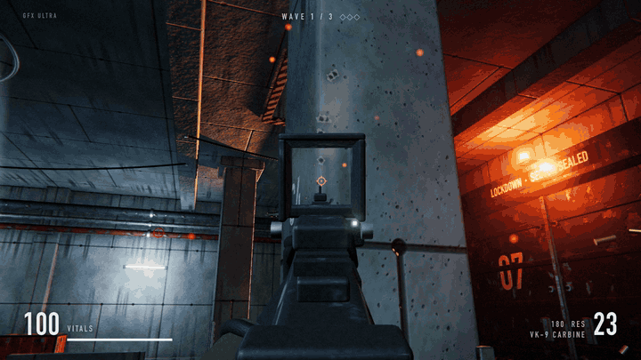
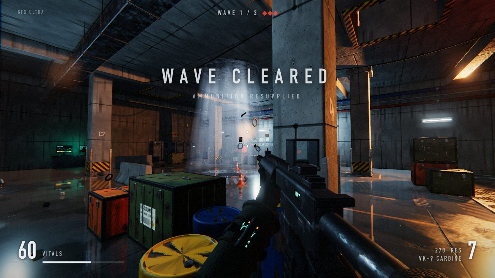
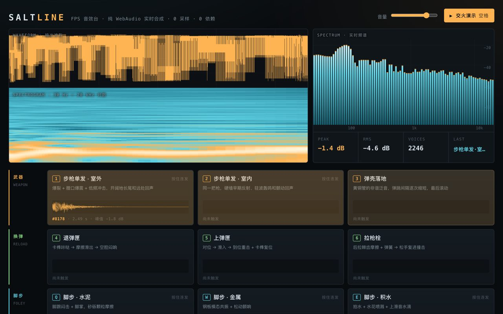
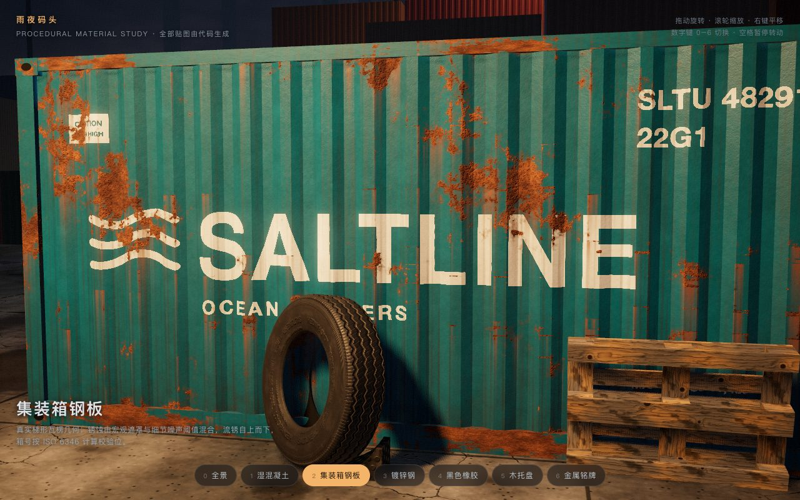
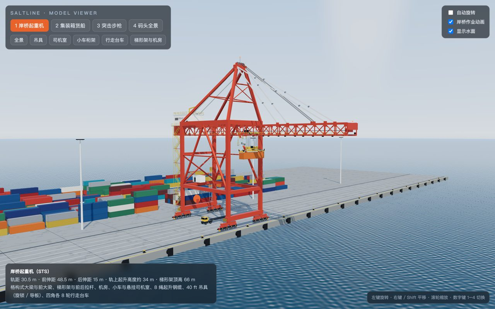
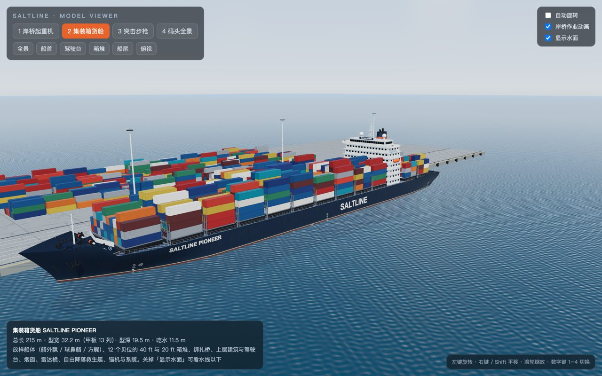
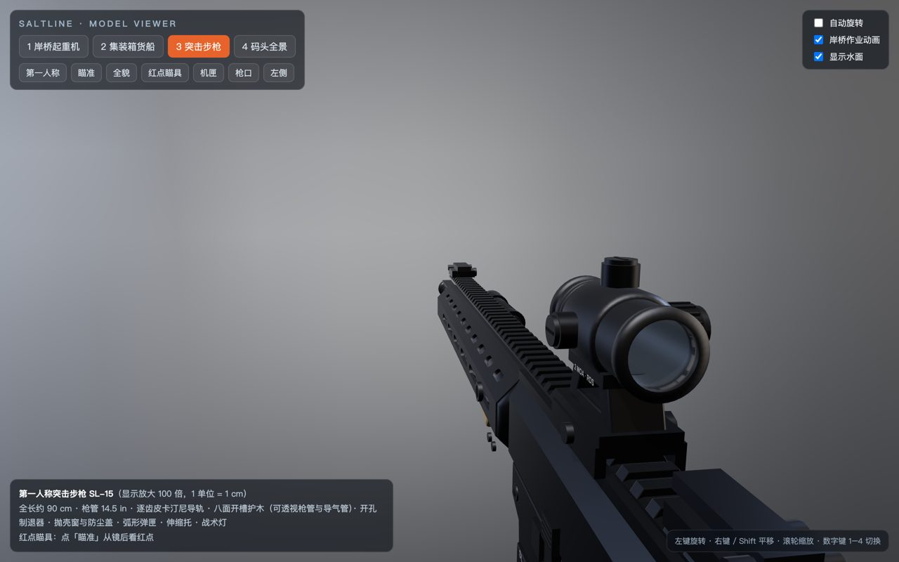

<h1 align="center">fable52-fps-repro</h1>

<p align="center">Build a 3D FPS from a single prompt: 4 standalone code-generation experiments with Fable 5.2 (Anthropic's large model), inspired by Saltline—complete with single-file playable demos, exact prompts, runner scripts, and token billing data.</p>

<p align="center"><a href="README.md">简体中文</a> · <a href="README.en.md">English</a> · <a href="README.ja.md">日本語</a></p>

<p align="center">
  <a href="https://wquguru.github.io/fable52-fps-repro/"></a>
  <a href="https://x.com/wquguru"></a>
</p>

<p align="center">
  
  
  
</p>

<p align="center">⭐ Star this repo if the prompts, headless runner, and prompt-caching breakdown help your own agent runs</p>

<p align="center">
  
</p>

<p align="center"><sub>Experiment 04 in action: a 131 KB single-file HTML FPS with wet floor reflections, a red-dot carbine, and 3 waves of drones—built autonomously in 73 turns for $15.96 in API-equivalent tokens</sub></p>

## Quick Start

```bash
git clone https://github.com/wquguru/fable52-fps-repro && cd fable52-fps-repro
scripts/run.sh 01-audio prompts/01-audio.md 5m 12
python3 scripts/metrics.py
```

<details><summary>Prerequisites & Repository Layout</summary>

**Prerequisites**
- Claude Code `2.1.242+` installed.
- Access to the `claude-fable-5-2` model (via subscription or API key).
- Optional: `agent-browser` and Chrome if you want the agent to take screenshots and inspect its own WebGL output.
- The last argument in `run.sh` (e.g., `12`) sets `--max-budget-usd` so the run stops automatically if it hits your cap.

**Directory Structure**
```text
fable52-fps-repro/
  index.html                 GitHub Pages landing page (links to all 4 demos)
  demos/01-audio/            Procedural soundboard (5m cache run)
  demos/01-audio-1h/         Same task, 1h cache run
  demos/02-materials/        Procedural materials showcase
  demos/03-models/           Procedural hard-surface models
  demos/04-fps/              SUBLEVEL 07 complete FPS
  prompts/                   Raw prompts 01–04, builder_system.md, builder_system_04.md (adds isolated session for agent-browser)
  scripts/run.sh             One-command headless experiment runner
  scripts/metrics.py         Aggregates runs/*.json costs & cache hits → data/metrics.tsv
  scripts/rec/               Frame-by-frame recorder for 04 (steps via built-in __dbg.step)
  data/metrics.tsv           Measured billing & token data across my 5 runs
  docs/demo.gif, docs/screens/  Gameplay GIF and screenshots
```

</details>

What you get:

- 4 self-contained browser demos (single-file HTML with zero external textures, 3D models, or audio files).
- Exact prompts and system instructions ready for unattended headless runs.
- Raw token counts, cache hit rates, and API-equivalent cost breakdowns across 5 runs.

## Use Cases

| Scenario | Example | What You Get |
|---|---|---|
| Reproduce a one-prompt 3D game | Run `prompts/04-fps.md` | A 131 KB single-file FPS with 3 drone waves, carbine reload mechanics, and 18 synthesized sound effects |
| Study procedural asset generation | Run `01-audio`, `02-materials`, or `03-models` | Web Audio synth effects/music, shader-driven wet concrete and shipping containers, and procedural cranes/ships/rifles |
| Audit prompt-caching economics | Run with `5m` or `1h` TTL and execute `metrics.py` | A TSV breakdown comparing actual cached spend against uncached baseline pricing |

## Showcases

Inspired by Felix Rieseberg's viral post about building the browser FPS *Saltline* with Fable 5.2, I designed and ran 4 standalone experiments from scratch. These outputs are my own independent runs—they are not *Saltline* and contain zero code from *Saltline*.

<table>
<tr>
<td width="50%" valign="top">
<br>
<b>04 · SUBLEVEL 07 Complete FPS</b> · 131 KB HTML<br>
Prompted with the original one-liner, Fable 5.2 built a flooded underground substation, 3 drone waves, real-time floor reflections, and 18 synth sounds, then wrote an automated script to beat all 3 waves with zero console errors (downsides: blocky forearms/gloves and floor-only reflections).<br>
<a href="https://wquguru.github.io/fable52-fps-repro/demos/04-fps/">Play Online</a> · <a href="prompts/04-fps.md">Prompt</a>
</td>
<td width="50%" valign="top">
<br>
<b>01 · Procedural Soundboard</b> · 56 KB HTML<br>
14 Web Audio synthesized sounds (indoor/outdoor rifle shots, 3-part reload, shell casings, 3 footstep surfaces, rain, thunder, and a 30s music loop) plus a self-added firefight demo and offline clipping/silence checks.<br>
<a href="https://wquguru.github.io/fable52-fps-repro/demos/01-audio/">Play (5m cache)</a> · <a href="https://wquguru.github.io/fable52-fps-repro/demos/01-audio-1h/">Play (1h cache)</a> · <a href="prompts/01-audio.md">Prompt</a>
</td>
</tr>
<tr>
<td width="50%" valign="top">
<br>
<b>02 · Rainy Dock Materials</b> · 55 KB HTML<br>
Uses only Three.js from CDN and zero external images to generate wet concrete puddles with real-time reflections, rusted corrugated containers with stenciled IDs, galvanized steel, and brass plaques (downsides: some small pits misclassified as puddles, flat-shaded distant stacks).<br>
<a href="https://wquguru.github.io/fable52-fps-repro/demos/02-materials/">Play Online</a> · <a href="prompts/02-materials.md">Prompt</a>
</td>
<td width="50%" valign="top">
<br>
<b>03 · Hard-Surface Models</b> · 69 KB HTML<br>
Procedurally assembled quay crane (with animated spreader and 8 cables), 215m container ship, and red-dot carbine, plus a self-added ~1.85M-triangle full port panorama running at ~120 fps on an Apple M2 Pro (downside: no first-person arms).<br>
<a href="https://wquguru.github.io/fable52-fps-repro/demos/03-models/">Play Online</a> · <a href="prompts/03-models.md">Prompt</a>
</td>
</tr>
</table>

<p align="center">
  
  
</p>

## Measured Results & Cost Breakdown

Conditions: All runs were executed on 2026-11-10 using Claude Code `2.1.322` with `claude-fable-5-2`. I ran these under my subscription quota (so I did not pay out of pocket); the dollar figures are API-equivalent costs reported by Claude Code and verified item-by-item against official Fable 5.2 pricing ($8/M input, $10/M 5m cache write, $16/M 1h cache write, $0.20/M cache hit, $40/M output). Each experiment was run once.

| Experiment | Duration | Turns | Total Input Tokens | Cache Hit Rate | Output Tokens | API-Equiv. Cost | Uncached Cost |
|---|---|---|---|---|---|---|---|
| 01 Audio (5m cache) | 16.6 min | 16 | 1.17M | 88.6% | 78K | $4.66 | $12.47 |
| 01 Audio (1h cache control) | 18.8 min | 16 | 1.29M | 78.6% | 91K | $6.97 | $13.98 |
| 02 Materials | 23.9 min | 25 | 2.46M | 83.8% | 114K | $8.56 | $24.24 |
| 03 Models | 28.7 min | 19 | 2.05M | 76.1% | 140K | $10.38 | $21.96 |
| 04 One-Prompt FPS (1h cache) | 40.8 min | 73 | 6.61M | 90.9% | 193K | $15.96 | $60.57 |

Across experiments 01–04 (excluding the 1h audio control), total API-equivalent cost was ~$39.6 (~$47 including the control run and smoke tests). Experiment 04 achieved a 90.9% cache hit rate, matching the 90%–95% range I back-calculated from the original Saltline post.

See [`data/metrics.tsv`](data/metrics.tsv) for the raw numbers and [`scripts/metrics.py`](scripts/metrics.py) for the pricing calculation.

## How It Works

```text
[Task Prompt + Builder System Prompt]
                  │
                  ▼
[Unattended Claude Code Headless Loop] ──(seconds between turns → cache stays warm)
                  │
                  ├─ 1. Write single-file HTML (inline Three.js, shaders, Web Audio synths)
                  ├─ 2. Launch agent-browser on hardware WebGL (Apple M2 Pro)
                  ├─ 3. Take screenshots / run offline audio checks / auto-play 3 waves
                  └─ 4. Read console logs & visual checks, patch code until zero errors
```

1. **Unattended Headless Execution**: Because newly created custom subagents inside an interactive session require restarting Claude Code to register, `scripts/run.sh` runs each experiment in non-interactive headless mode from start to finish without human intervention.
2. **High Input-to-Output Ratio & Prompt Caching**: Long agent runs re-read the growing file every turn. Because Fable 5.2 cache hits cost 0.025x the base input rate ($0.20 vs $8.00/M), back-to-back turns keep the cache warm and cut Experiment 04's cost from $60.57 down to $15.96.
3. **Self-Verification Loop**: Using `agent-browser`, the model opens its own page on a real GPU (Apple M2 Pro), inspects screenshots, checks audio buffers offline for clipping, and drives the game loop to verify win/loss states.

## FAQ

<details>
<summary>How is this related to Felix Rieseberg's Saltline?</summary>

On 2026-11-09, Anthropic's Felix Rieseberg shared *Saltline*, a browser FPS generated from a single prompt with Fable 5.2 over 8 hours (445M input tokens, 2.7M output tokens, ~$550 API value).

This repo is my own independent reproduction of that workflow across 4 experiments. Experiments 01–03 test procedural audio, materials, and modeling individually. Experiment 04 feeds his prompt, minus the leading *"You know, you should also"* plus a constraint for single-file HTML with CDN-only Three.js and no external assets, into a fresh directory, where Fable 5.2 invented *SUBLEVEL 07*. None of the demos here are *Saltline*, and no *Saltline* code is included.

</details>

<details>
<summary>Why do demos 01–03 say "SALTLINE" on the UI?</summary>

Claude Code inspects its working directory. I ran experiments 01–03 inside a subfolder of my writing repo that had `saltline` in the folder path (which also auto-loaded an unrelated writing `AGENTS.md`), and Fable 5.2 picked up the name for the UI headers. For Experiment 04, I ran it in an empty directory with no `CLAUDE.md` or `AGENTS.md`, and the model named its game *SUBLEVEL 07*.

</details>

<details>
<summary>How much does it cost to run this yourself?</summary>

If you run it within your Claude Code subscription allowance, there is no extra charge. At official API rates, running experiments 01 through 04 cost ~$39.6 total, with the 73-turn complete FPS costing $15.96. You can cap spend per run via the budget argument in `scripts/run.sh`.

</details>

<details>
<summary>Did a human listen to and grade the 14 sounds in Experiment 01?</summary>

Fable only ran offline rendering checks (testing for clipping and silence) and noted in its final report that the audio was not auditioned by human ears. These sounds have not been individually reviewed by human ears—feel free to open an issue after listening.

</details>

<details>
<summary>Does the 1-hour cache save more money than the 5-minute cache?</summary>

Not in my single side-by-side test. Running the exact same 01 audio prompt twice in parallel cost $4.66 with a 5m cache TTL and $6.97 with a 1h cache TTL—a $2.31 difference.

Higher 1h cache write pricing ($16 vs $10/M) only accounted for ~$0.68 of that gap; the rest came from the 1h run happening to incur ~160K more uncached input tokens (~$1.29) and 12.5K more output tokens (~$0.50) for reasons I didn't pin down. Since each condition was only run once, this isn't a statistically conclusive benchmark. Mechanistically, when an agent works continuously with only a few seconds between turns, a 5m cache refreshes itself on every turn; the 1h cache is meant for workflows with >5 minute pauses.

</details>

## Roadmap

- Keep the 5 original runs and token logs archived as a reproducible baseline.
- Welcome community PRs adding `data/` rows from other models or cache configurations using the same `prompts/`.

## Community

- Questions & reproduction notes: [GitHub Issues](https://github.com/wquguru/fable52-fps-repro/issues) / [Discussions](https://github.com/wquguru/fable52-fps-repro/discussions)
- Full write-up & future experiments: Follow [@wquguru](https://x.com/wquguru) on X

## Acknowledgements

- Inspired by Felix Rieseberg's 2026-11-09 post and prompt for *Saltline*.
- 3D rendering powered by [three.js](https://threejs.org/).

## License

[MIT](LICENSE)
