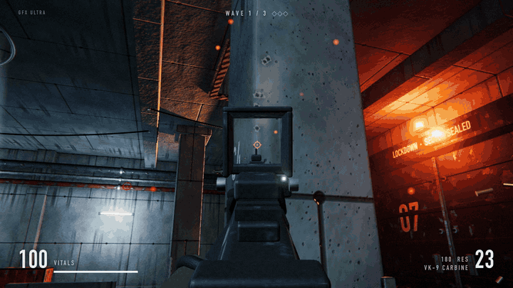
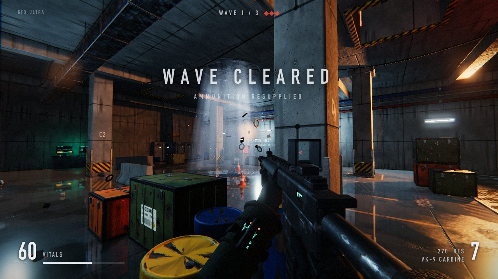
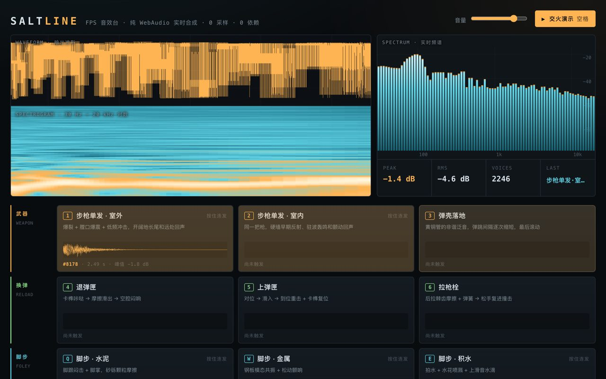
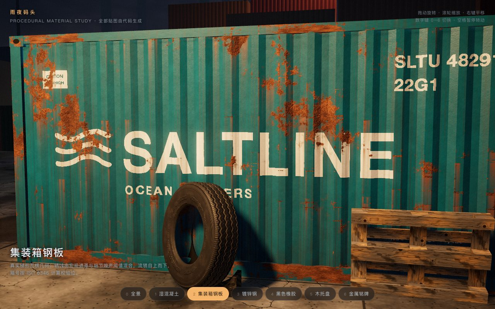
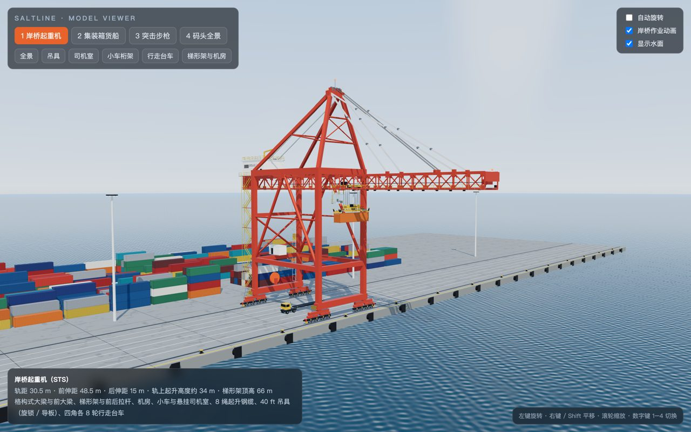
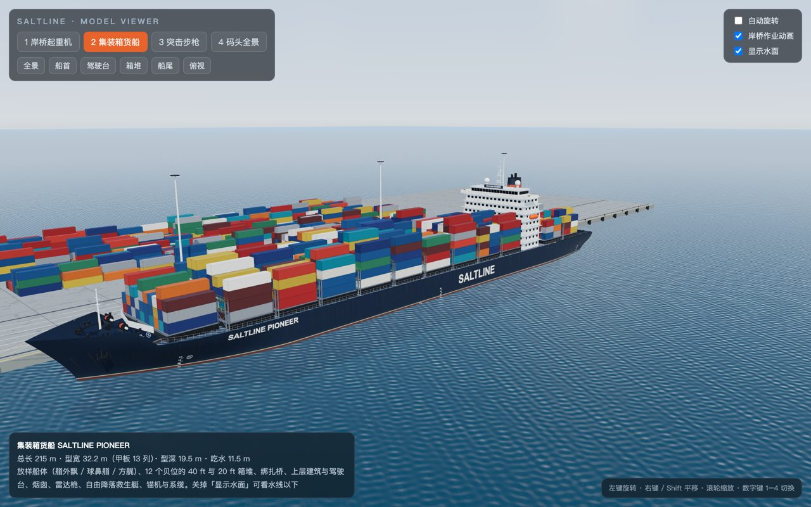
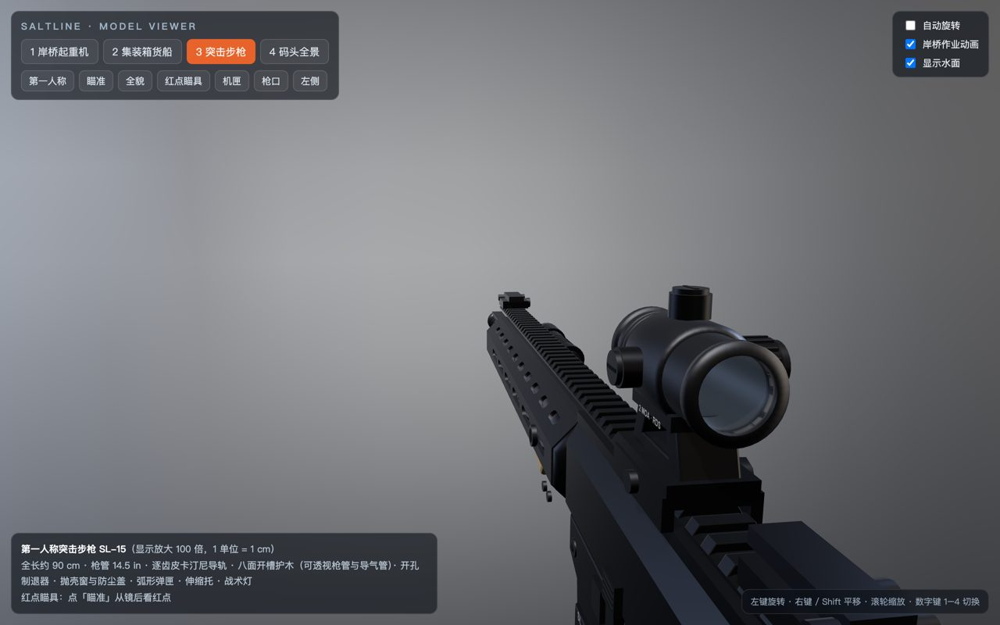

<h1 align="center">fable52-fps-repro</h1>

<p align="center">1行のプロンプトからAIがゼロベースで3D FPSを構築：Saltlineに触発され、Fable 5.2（Anthropicの大規模モデル）で実行した4つの純コード生成実験。単一HTMLの完成品、プロンプト、実行スクリプト、トークン課金データをすべて公開しています。</p>

<p align="center"><a href="README.md">简体中文</a> · <a href="README.en.md">English</a> · <a href="README.ja.md">日本語</a></p>

<p align="center">
  <a href="https://wquguru.github.io/fable52-fps-repro/"></a>
  <a href="https://x.com/wquguru"></a>
</p>

<p align="center">
  
  
  
</p>

<p align="center">⭐ プロンプト集やヘッドレス実行スクリプト、プロンプトキャッシュのコスト内訳が参考になったら、ぜひ Star をお願いします</p>

<p align="center">
  
</p>

<p align="center"><sub>実験 04 のプレイ映像：131 KB の単一 HTML ファイル。濡れた床のリアルタイム反射、ドットサイト付きカービン銃で3ウェーブの浮遊ドローンを迎え撃つ FPS。全73ターン無人生成、API換算コストは $15.96</sub></p>

## クイックスタート

```bash
git clone https://github.com/wquguru/fable52-fps-repro && cd fable52-fps-repro
scripts/run.sh 01-audio prompts/01-audio.md 5m 12
python3 scripts/metrics.py
```

<details><summary>前提条件とディレクトリ構成</summary>

**動作環境**
- Claude Code（Anthropic の CLI コーディングツール）`2.1.242` 以降がインストールされていること。
- アカウントで `claude-fable-5-2` モデルが利用可能であること（サブスクリプション枠、APIキーのどちらでも可）。
- モデル自身にブラウザを開かせてスクリーンショットによる自己検証を行わせる場合は、`agent-browser` と Chrome が必要です。
- スクリプトの最後の引数（例：`12`）は `--max-budget-usd` に渡される1回あたりの予算上限（米ドル）です。上限に達すると自動で停止します。

**ディレクトリ構成**
```text
fable52-fps-repro/
  index.html                 GitHub Pages トップページ（4つのデモへのリンク）
  demos/01-audio/            サウンドボード（5分キャッシュ実行分）
  demos/01-audio-1h/         同一タスクの1時間キャッシュ実行分
  demos/02-materials/        マテリアル検証
  demos/03-models/           モデリング検証
  demos/04-fps/              SUBLEVEL 07 完全版 FPS
  prompts/                   01–04 の生プロンプト、builder_system.md（追加システムプロンプト）、builder_system_04.md（04 用：agent-browser を独立セッションで動かす1行を追加）
  scripts/run.sh             コマンド1つで各実験を回すランナー
  scripts/metrics.py         runs/*.json のコストとキャッシュヒット率を集計 → data/metrics.tsv
  scripts/rec/               04 用のフレーム単位録画スクリプト（ゲーム内蔵の __dbg.step を呼び出してコマ送り記録）
  data/metrics.tsv           全5回の実行で計測した実測データ
  docs/demo.gif、docs/screens/  プレイ GIF とスクリーンショット
```

</details>

このリポジトリに含まれるもの：

- ブラウザで開くだけですぐ遊べる、コードのみで生成された 3D デモ 4本（単一 HTML ファイル、外部の画像・3Dモデル・音声ファイルへの依存ゼロ）。
- CLI にそのまま渡して無人実行できるプロンプト原文とシステムプロンプト 4セット。
- 全5回の実行におけるトークン消費量、キャッシュヒット率、API料金換算のコストデータ。

## ユースケース

| 用途 | 実行例 | 得られる結果 |
|---|---|---|
| 1行プロンプトからのゲーム生成を再現 | `04-fps` のプロンプトを実行 | 131 KB の単一 HTML シューティングゲーム（3ウェーブのドローン戦、カービン銃のリロード、18種類の合成効果音入り） |
| コードによるアセット生成の仕組みを解剖 | `01-audio`、`02-materials`、`03-models` を個別に実行 | 外部アセットなしで、Web Audio による銃声や BGM の合成、シェーダーによる水たまりや錆の表現、プリミティブの組み合わせによる貨物船やライフルのモデリングを確認 |
| 長時間タスクのキャッシュ効率を検証 | `5m` または `1h` を指定して実行後に `metrics.py` を回す | `runs/*.json` を自動集計し、キャッシュヒット率、API換算コスト、キャッシュなしの場合の比較金額をまとめた TSV を出力 |

## ショーケース

Anthropic の Felix Rieseberg 氏が Fable 5.2 を使ってブラウザ FPS「Saltline」を作ったという X の投稿に着想を得て、私自身が独自に設計・実行した4つの実験です。生成された作品は Saltline ではなく、リポジトリ内にも Saltline のコードは一切含まれていません。

<table>
<tr>
<td width="50%" valign="top">
<br>
<b>04 · SUBLEVEL 07 完全版 FPS</b> · 131 KB 単一ファイル<br>
元ポストの1行プロンプトだけから、濡れた地下変電所、3ウェーブのドローン戦、床のリアルタイム反射、18種類の合成効果音を生成。AI自身が自動テストスクリプトを書いて3ウェーブをクリアし、コンソールエラーゼロまで検証しました（弱点：前腕とグローブの造形が簡素、反射が床のみ）。<br>
<a href="https://wquguru.github.io/fable52-fps-repro/demos/04-fps/">ブラウザで遊ぶ</a> · <a href="prompts/04-fps.md">プロンプト</a>
</td>
<td width="50%" valign="top">
<br>
<b>01 · プロシージャル効果音スタジオ</b> · 56 KB 単一ファイル<br>
コードのみで14種類のサウンド（屋内外の銃声、3段階のリロード音、薬莢の落下音、3種類の足音、雨と雷、30秒のループBGM）を合成。AIが自発的に銃撃戦デモボタンを追加し、オフラインレンダリングで音割れ（クリッピング）や無音区間がないか自己検査しました。<br>
<a href="https://wquguru.github.io/fable52-fps-repro/demos/01-audio/">遊ぶ（5m）</a> · <a href="https://wquguru.github.io/fable52-fps-repro/demos/01-audio-1h/">1h 比較版</a> · <a href="prompts/01-audio.md">プロンプト</a>
</td>
</tr>
<tr>
<td width="50%" valign="top">
<br>
<b>02 · 雨の夜の埠頭マテリアル</b> · 55 KB 単一ファイル<br>
CDN 経由の Three.js のみを使用し、外部画像はゼロ。濡れたコンクリートの水たまりのリアルタイム反射、ステンシル番号入りの錆びた波板コンテナ、亜鉛メッキ鋼、真鍮プレートをシェーダーとコードで生成（弱点：小さな窪みの一部が水たまりと誤判定される、遠景のコンテナ群が単色塗り）。<br>
<a href="https://wquguru.github.io/fable52-fps-repro/demos/02-materials/">ブラウザで遊ぶ</a> · <a href="prompts/02-materials.md">プロンプト</a>
</td>
<td width="50%" valign="top">
<br>
<b>03 · ハードサーフェス・モデリング</b> · 69 KB 単一ファイル<br>
荷役アニメーション付きのガントリークレーン、全長215メートルのコンテナ船、ドットサイト付きライフルをコードだけで組み立て。さらにAI自身が約185万ポリゴンの埠頭フルパノラマタブを追加し、Apple M2 Pro 実機で約 120 fps で動作します（弱点：一人称視点に腕の表示がない）。<br>
<a href="https://wquguru.github.io/fable52-fps-repro/demos/03-models/">ブラウザで遊ぶ</a> · <a href="prompts/03-models.md">プロンプト</a>
</td>
</tr>
</table>

<p align="center">
  
  
</p>

## 検証結果と実測コスト

計測条件：以下のデータはすべて 2026-11-10 に Claude Code `2.1.322` 上で `claude-fable-5-2` を使用して計測したものです。実際にはサブスクリプション枠内で実行したため直接の支払いは発生していませんが、表の金額は Claude Code が公式 API 単価（入力 $8 / 1M、5分キャッシュ書き込み $10 / 1M、1時間キャッシュ書き込み $16 / 1M、キャッシュヒット $0.20 / 1M、出力 $40 / 1M）に基づいて自動算出した API 換算額であり、スクリプトで項目ごとに再計算して一致を確認しています。各実験は1回ずつのみ実行しました。

| 実験 | 所要時間 | ターン数 | 総入力トークン | キャッシュヒット率 | 出力トークン | API換算コスト | キャッシュなし換算 |
|---|---|---|---|---|---|---|---|
| 01 サウンドボード（5分キャッシュ） | 16.6 分 | 16 ターン | 117 万 | 88.6% | 7.8 万 | $4.66 | $12.47 |
| 01 サウンドボード（1時間キャッシュ比較） | 18.8 分 | 16 ターン | 129 万 | 78.6% | 9.1 万 | $6.97 | $13.98 |
| 02 マテリアル | 23.9 分 | 25 ターン | 246 万 | 83.8% | 11.4 万 | $8.56 | $24.24 |
| 03 モデリング | 28.7 分 | 19 ターン | 205 万 | 76.1% | 14.0 万 | $10.38 | $21.96 |
| 04 1行プロンプト FPS（1時間キャッシュ） | 40.8 分 | 73 ターン | 661 万 | 90.9% | 19.3 万 | $15.96 | $60.57 |

4つの実験の合計（1時間キャッシュの比較実験を除く）は API 換算で約 $39.6、比較実験とスモークテストを含めると合計で約 $47 でした。実験 04 のキャッシュヒット率は 90.9% で、元ポストの数値から逆算した 90%–95% のレンジに収まっています。

集計元の生データは [`data/metrics.tsv`](data/metrics.tsv)、再計算ロジックは [`scripts/metrics.py`](scripts/metrics.py) を参照してください。

## 仕組み

```text
[タスクプロンプト + 追加システムプロンプト]
         │
         ▼
[Claude Code ヘッドレス無人ループ] ──(ターン間隔は数秒、キャッシュを維持)
         │
         ├─ 1. 単一 HTML を記述（Three.js、シェーダー、Web Audio シンセをインライン化）
         ├─ 2. agent-browser を起動し、実 GPU（Apple M2 Pro）環境でページを開く
         ├─ 3. スクショで画面確認 / オフラインレンダリングで音割れ検査 / 自動スクリプトで3ウェーブ突破
         └─ 4. コンソールエラーとスクショを読み取り、エラーゼロになるまでコードを修正
```

1. **CLI でのヘッドレス無人実行**：対話セッション内でカスタム subagent を新規作成すると、登録に Claude Code の再起動が必要になるため、`scripts/run.sh` から非対話のヘッドレスモードを呼び出し、プロンプトと予算上限を一度に渡して最後まで人間の介入なしで完走させています。
2. **高い入出力比とプロンプトキャッシュの維持**：モデルは1回でゲーム全体を出力するわけではなく、何十ターンもコード全体を読み直しながら修正を重ねます。Fable 5.2 のキャッシュヒット単価は通常入力の 0.025 倍（$0.20 vs $8.00 / 1M）なので、ターン間隔が数秒であればキャッシュが途切れず、実験 04 のコストを $60.57 から $15.96 に圧縮できました。
3. **ブラウザ自己検証ループ**：システムプロンプトで `agent-browser` の使用を許可しており、モデル自身が書いた HTML を開いてスクリーンショットを撮り（Apple M2 Pro のハードウェア WebGL で動作していることを確認）、実験 04 では自動テストスクリプトを自作して3ウェーブの戦闘を突破し、勝利・敗北画面の遷移まで検証しています。

## よくある質問（FAQ）

<details>
<summary>Felix Rieseberg 氏の Saltline とはどういう関係ですか？</summary>

2026-11-09 に Anthropic の Felix Rieseberg 氏が、Fable 5.2 に1行のプロンプトを与えてブラウザ FPS「Saltline」を生成した事例を X に投稿しました（8時間稼働、入力 445M トークン、出力 2.7M トークン、API換算で約 $550）。

本リポジトリはそれに触発され、独自のプロンプトとスクリプトで4つの実験に分けてワークフローを検証したものです。最初の3つでサウンド、マテリアル、モデリングを個別に検証し、4つ目の実験では氏が公開したプロンプト（冒頭の `You know, you should also` を削り、単一 HTML・CDN のみ使用・外部ファイル読み込みなしという環境制約を1文追加したもの）をそのまま渡して自由に作らせた結果、モデルが地下変電所をテーマにした `SUBLEVEL 07` を作り上げました。本リポジトリの成果物は Saltline ではなく、Saltline のコードも一切含まれていません。

</details>

<details>
<summary>なぜ 01〜03 の画面には「SALTLINE」と表示されているのですか？</summary>

私が踏んだ落とし穴です。エージェントは作業時にカレントディレクトリや周囲のコンテキストを参照します。実験 01〜03 は私の執筆用リポジトリ内の `saltline` という名前が入ったサブフォルダで実行したため（しかもゲームとは無関係な執筆ルール `AGENTS.md` まで自動で読み込まれていました）、Fable 5.2 がフォルダ名から `SALTLINE` を拾って UI の見出しに使ってしまいました。実験 04 では `CLAUDE.md` や `AGENTS.md` が一切ない空のディレクトリに移して実行したため、モデル自身が `SUBLEVEL 07` という新しいタイトルを付けています。

</details>

<details>
<summary>自分で一通り動かすとどれくらい費用がかかりますか？</summary>

Claude Code のサブスクリプション枠内で実行する場合、枠内であれば追加課金は発生しません。Fable 5.2 の公式 API 価格で換算すると、私が 01 から 04 までの4実験を回した合計は約 $39.6 で、最も重い 04 の完全版 FPS（73ターン）が $15.96 でした。予算オーバーを防ぐため、`scripts/run.sh` の最後の引数で `--max-budget-usd` の上限を設定できます。

</details>

<details>
<summary>実験 01 で合成された14種類の効果音は、人間の耳でチェックしましたか？</summary>

Fable はオフラインレンダリングによる波形検査（クリッピングと無音のチェック）のみを行っており、最終レポートにも「人間の耳による試聴は行っていない」と明記しています。これらの効果音は人間の耳で個別に審査したものではありませんので、実際に聴いてみて気づいた点があればぜひ Issue で教えてください。

</details>

<details>
<summary>1時間キャッシュの方が5分キャッシュより安くなりますか？</summary>

私が1回だけ行った並列比較実験では、安くなりませんでした。同じ 01 のサウンド生成タスクを並列で2回走らせたところ、5分キャッシュが $4.66 だったのに対し、1時間キャッシュは $6.97 かかり、$2.31 高くなりました。

内訳を見ると、1時間キャッシュの書き込み単価が高いこと（$16 vs $10 / 1M トークン）による差額は約 $0.68 にとどまり、残りは1時間キャッシュ側の実行でたまたまキャッシュミス入力が約16万トークン（約 $1.29）、出力が1.25万トークン（約 $0.50）多く発生したためでした（正確な原因は特定できていません）。各条件とも1回しか実行していないため、どちらが確実に安いかを断定することはできません。公式ドキュメントの仕様上、エージェントが連続稼働してリクエスト間隔が数秒に収まる場合は5分キャッシュでも毎回自動で延長されるため、1時間キャッシュは途中に5分以上の空白（人間の確認待ちや長時間ビルドなど）が入るケースに向いています。

</details>

## ロードマップ

- 再現実験のベースラインとして、全5回の生成物とトークン課金ログをこのままアーカイブとして維持します。
- 他のモデルや異なるキャッシュ設定で同じ `prompts/` を回し、`data/` に比較データを追加する PR を歓迎します。

## コミュニティ

- 質問や再現結果の共有：[GitHub Issues](https://github.com/wquguru/fable52-fps-repro/issues) / [Discussions](https://github.com/wquguru/fable52-fps-repro/discussions)
- 詳細な解説記事と今後の実験：X で [@wquguru](https://x.com/wquguru) をフォローしてください

## 謝辞

- 2026-11-09 に Felix Rieseberg 氏が投稿した Saltline のポストとプロンプトに着想を得ています。
- 3D レンダリングにはオープンソースの [three.js](https://threejs.org/) を使用しています。

## License

[MIT](LICENSE)
